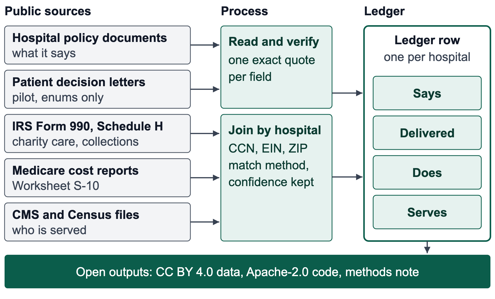
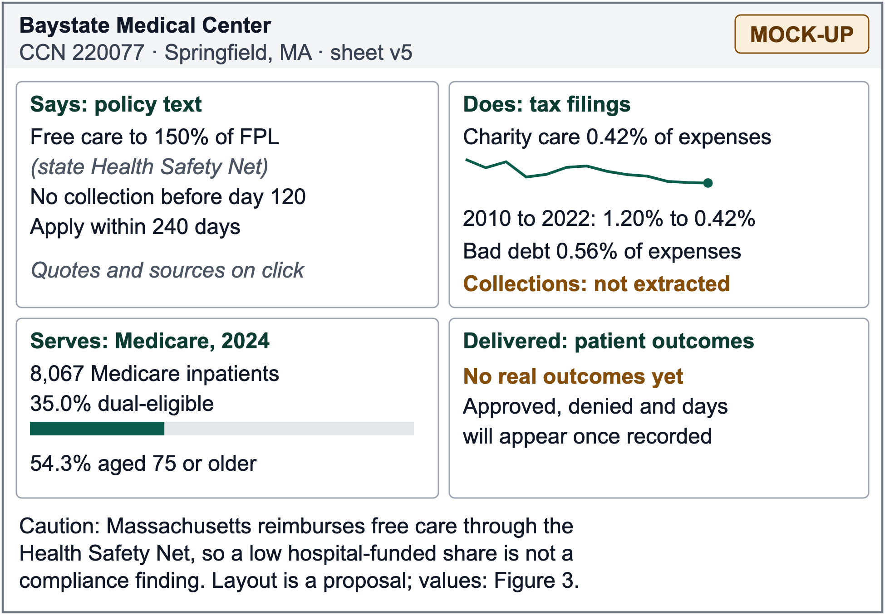
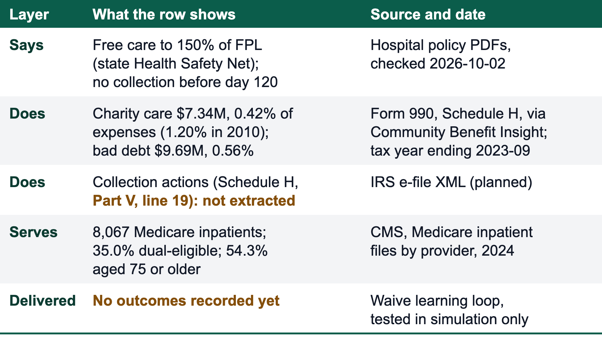
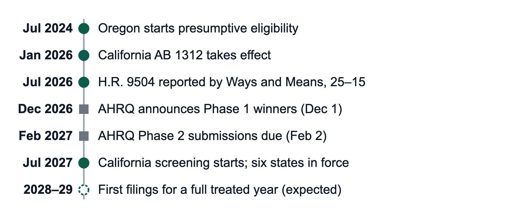

# AHRQ Healthcare Choice and Competition Challenge: Phase 1 entry (draft for founder review)

Prepared 2026-10-16 on branch `claude/ahrq-entry-65c458`. Status: draft. Nothing in this file has been submitted, emailed or posted by anyone; the founder files it.

| Part | What it is | Goes to AHRQ? |
|---|---|---|
| A | Requirements summary, with URLs | No |
| B | The entry (the text between the START and END markers) | Yes, as a PDF |
| C | Submission checklist with dates, and the commands to render and check the PDF | No |
| D | Claims to confirm or soften, and every `[USER FILLS]` item | No |
| E | Sources read this session, and how | No |

## Part A. Requirements summary (not part of the submission)

Read in full on 2026-10-16 from [the challenge page](https://www.ahrq.gov/healthcarechoice/index.html), [the registration form page](https://www.ahrq.gov/healthcarechoice/register.html) and [HHS Gold Standard Science](https://www.hhs.gov/gss/index.html). The challenge is authorized by the America COMPETES Reauthorization Act of 2010 (15 U.S.C. § 3719). Prizes are cash prizes, not grants or contracts.

| Item | Requirement |
|---|---|
| Deadline | Phase 1 submissions close **Monday 2026-10-26, 5 p.m. ET** (EDT, UTC-4 on that date: 21:00 UTC, or 2 p.m. PT). The period opened Wednesday 2026-09-30, 5 p.m. ET. |
| Later dates | Phase 1 winners announced Tuesday 2026-12-01. Phase 2 submissions open Tuesday 2026-12-15 and close Tuesday 2027-02-02, 5 p.m. ET. Phase 2 winners announced Friday 2027-03-05. |
| Prizes | Pool of $11.8M. Phase 1: up to five submissions, "no more than $3 million in total". Phase 2: up to five, no more than $8.8M in total. Winners may spend prize money as they choose, including on a later phase. If AHRQ fails to pay, HHS will not pay in its place. |
| Who may enter | An individual, a team or an entity. A private entity must be incorporated in, and maintain its primary place of business in, the United States; there is no nonprofit requirement, so **for-profit entities are eligible**. An individual or team member must be a US citizen or permanent resident, 18 or older. Not eligible: federal entities, federal employees acting within the scope of employment, HHS employees in a personal capacity, challenge judges and anyone involved in the design, production, execution or distribution of the challenge, and their immediate family (spouse, parent, stepparent, child, stepchild). Federal employees outside HHS must consult an agency ethics official. |
| Sole proprietors | Not mentioned. A sole proprietor is the individual: register as an individual, or as an entity if a corporation or LLC exists. Confirm with AHRQ (Part C). |
| Funding rule | No federal grant or cooperative-agreement funds, and no federal contract funds, may be used to develop the submission. The form asks two yes/no questions on this; a yes means stop and contact the administrator. |
| Registration | Email **one signed PDF** of the HHS Challenge Participant Registration Form, per submission, to HealthcareChoice@ahrq.hhs.gov. No Challenge.gov login and no SAM.gov registration are required. A Unique Entity ID is optional, and the form says not to give a tax identification number. Choose individual, team or entity: that choice decides who is paid (an individual is paid directly, a team through its leader, an entity itself). No separate registration deadline is stated. |
| Form contents | Section 1: submission title, phase, and a short statement of how the research advances the challenge objectives. Section 2: the two funding questions and six eligibility certifications. Section 3, 4 or 5: data for an individual, a team or an entity. Section 6: participation agreement and signature. Section 7: one signed copy for each additional team member or entity participant. A PDF version of the form is linked from the registration page. |
| Submission | Email the submission to HealthcareChoice@ahrq.hhs.gov. It should be "limited to 15 single-spaced pages, with a font size no smaller than 11-point Arial and with margins no smaller than 1 inch". There is no required format. |
| What Phase 1 should discuss | (1) The policies the participant will examine, addressing the judging criteria, including economic significance and the extent to which the policies increase competition or patient choice and satisfaction. (2) The research to be pursued, rigorous and in line with the HHS Gold Standard Science Report. (3) The participant personnel, including how their experience and expertise position them to compete for Phase 2. |
| Phase 1 judging criteria | Potential Impact; Choice/Competition; Feasibility/Specificity; Novelty; Research Strength; Participant Personnel; Data, SI, and Reusability. Submissions are prescreened for eligibility and completeness, scored by a panel of technical experts, recommended by a federal judging panel, and decided by the Award Approving Official, Dr. Roger Klein, Director of AHRQ. |
| Rights and conduct | The participant warrants sole authorship or the right to use the work, and that it is original. HHS receives an irrevocable, paid-up, royalty-free, nonexclusive worldwide licence to reproduce, publish, post, link to, share and display the submission, and a nonexclusive licence to practise the solution; the participant keeps all other rights. No use of HHS marks and no implied endorsement. HHS may disqualify a submission it judges inconsistent with its public-health mission. Winners must return verification and payment documents by the date given. |
| Gold Standard Science | HHS lists nine tenets: reproducibility; transparency; communication of error and uncertainty; collaboration and interdisciplinary science; constructive skepticism of findings and assumptions; use of falsifiable hypotheses; use of unbiased peer review; acceptance of negative results as positive outcomes; minimizing conflicts of interest. |
| Contact | Jay Toven, Executive Officer, HealthcareChoice@ahrq.hhs.gov. |

Not stated on the pages: whether figures and references count toward the 15 pages (assumed yes), the file format of the submission (PDF assumed), whether AHRQ acknowledges receipt, and whether AI-assisted drafting must be disclosed.

## Part B. The entry

Submit only the text between the START and END markers below, rendered to PDF (`bash docs/grants/render-entry-pdf.sh`; details in Part C). The page budget was checked on 2026-10-16: the entry renders to 13 pages on US Letter with 1-inch margins and Arial 11 pt, with figures and references included. Everything in square brackets that starts with `USER FILLS` or `USER CONFIRMS` must be resolved or removed first.

<!-- ENTRY START -->

# The Hospital Financial-Assistance Ledger

**Open data to test disclosure and presumptive-eligibility reforms in nonprofit hospital care**

AHRQ Healthcare Choice and Competition Challenge, Phase 1 research proposal

Participant: [USER FILLS: full name or legal entity name]. Registration type: [USER FILLS: individual, team or entity]. Contact: [USER FILLS: email and phone]. Date: [USER FILLS: submission date].

## Summary

Nonprofit hospitals are exempt from federal income tax on condition that they publish a financial assistance policy, limit what eligible patients are charged, and make reasonable efforts to determine eligibility before they collect [1, 2]. Yet patients, employers, payers and regulators cannot easily compare what hospitals promise, what they deliver and how they collect: policies differ widely [3], most potentially eligible patients never apply [4], and federal reporting of community benefit is inconsistent [5]. We propose a research program built on the Hospital Financial-Assistance Ledger. It extends the open atlas of Waive, a free phone app that helps low-income seniors and their caregivers check a hospital bill against that hospital's own policy. The ledger links, for each nonprofit hospital, what its policy says (every field tied to an exact quote), what its tax filings and cost reports show it does, whom it serves, and, in a pilot, what patients report. We use it to test three reforms framed as information and simplification remedies rather than new mandates: a standard machine-readable policy disclosure (R1), a validated definition of application-outcome reporting (R2) and a presumptive-eligibility safe harbor (R3). Three falsifiable hypotheses will be tested in pre-registered analyses, using state mandates that take effect through July 2027 as natural experiments. Data, code and methods are open.

## 1. Potential impact

*Criterion: Potential impact. If enacted, would the policies have a substantial economic or health impact?*

**1.1 What the law requires, and what reaches patients.** Under section 501(r) of the Internal Revenue Code, a nonprofit hospital must, for each facility, assess community health needs, adopt a written financial assistance policy (FAP), limit charges to patients who qualify, and follow billing and collection rules; a facility's failure can lead to revocation of the organization's exemption [1]. The collection rules bar extraordinary collection actions (selling the debt, credit reporting, denying care, or legal process such as liens and lawsuits) until at least 120 days after the first post-discharge bill, give patients at least 240 days to apply, and require reasonable efforts to determine eligibility; a presumptive finding of ineligibility does not count as such efforts [2]. Within those rules hospitals choose their own income limits, documents and process, and in practice they differ widely. The benefit exists on paper and often does not reach the patient:

- *Patients do not get help.* In a national survey of people with a hospital bill they could not afford (late 2023; 1,628 respondents after weighting, 503 of them recruited from a nonprofit's mailing list), only 29% learned about, applied for and received charity care. Of those potentially eligible, 51% did not apply; the most common reason, given by 65% of non-applicants, was not knowing that assistance exists [4].
- *Policies cannot be compared.* Across about 2,500 hospitals, free-care income limits run from below 100% to 600% of the federal poverty level (FPL); 87% offer free care, 59% allow at least one extraordinary collection action, and only 10 to 15% say they will not take them [3].
- *Older adults carry the burden.* In 2022, 22% of US adults aged 65 and older reported debt from medical or dental bills; among those with debt, 62% said they or someone in their household had delayed, skipped or sought alternatives to needed care or medications because of cost in the past year [6]. Across all ages, people in the United States owed at least $220 billion in medical debt in 2021, and about 14 million people (6% of adults) owed more than $1,000 [7].
- *Oversight data are weak.* GAO found that Form 990 solicits community-benefit information inconsistently, which it says results in a lack of transparency, and that IRS could not show it had reviewed hospitals' community-benefit activities at least every three years as required [5].

**1.2 Three reforms the research will evaluate.**

*R1. A standard, machine-readable disclosure of the financial assistance policy.* A common schema (free-care ceiling and discount tiers, insured-patient and asset rules, deadlines, required documents, how to apply, covered facilities and providers, collection practices), published by each hospital as a file, in the manner of the machine-readable price files hospitals already post under a CMS rule meant to give patients the information to make well-informed decisions and to compare hospitals [8].

*R2. A validated definition of application-outcome reporting.* H.R. 9504, the Tax Exempt Hospital Transparency Act, was ordered reported by the House Committee on Ways and Means, 25 to 15, on 2026-07-01. As introduced, it would require each tax-exempt hospital organization to report the value of financial assistance at cost and the numbers of completed applications received, granted and denied, stated separately for each facility by large organizations (over 100 staffed beds) and high-revenue organizations (over $100 million in net patient revenue) [9]. Illinois already requires every hospital to file yearly counts of applications submitted, approved under presumptive eligibility, approved otherwise and denied, with the dollar value of assistance at cost [10], and Maine requires a written, dated statement of the reasons for each denial [11]. The bill counts applications "pursuant to the organization's financial assistance policy", so what counts as completed or denied follows each hospital's own policy, and we found no provision in the bill or the Illinois form for checking reported counts against independent evidence. We will propose a reporting specification (definitions, denial-reason codes, days to decision) and test it.

*R3. A presumptive-eligibility safe harbor.* IRS rules already let a hospital presume eligibility from other information, but a presumptive finding of ineligibility does not satisfy the reasonable-efforts test, and a finding of less than the most generous assistance requires notice and time to apply for more [2]. California's AB 1312 requires financial assistance screening and presumptive-eligibility determinations from 2027-07-01 [12]. By July 2027 six states (California, Delaware, Illinois, Maryland, North Carolina and Oregon) will require presumptive eligibility for certain patients, and Oregon's rule has applied since July 2024 [13]. A federal safe harbor that treats enrolment in a means-tested program the government already verifies as sufficient proof of eligibility would replace paperwork with data matching. We will study which designs raise access without raising hospital burden.

All three are information or simplification remedies. None sets a price or dictates whom a hospital must treat; each lets patients, payers and regulators see and act. Each will be evaluated net of hospital compliance burden, and we will report if burden outweighs benefit.

**1.3 Economic stakes.** Reported charity care already moves federal money. For fiscal year 2026 CMS set aside $7,713,127,500 for Medicare uncompensated-care payments, distributed among eligible hospitals in proportion to each hospital's share of uncompensated care reported on Worksheet S-10 of audited cost reports for fiscal years 2020 to 2022 [14]. CMS contractors review S-10 for compliance with hospitals' own charity-care policies and for the accuracy of bad debt and charity care amounts [15]. As arithmetic only, not an estimate: each 1% of that pool that shifts because S-10 amounts are mis-measured is about $77 million a year. A ledger that reconciles each hospital's stated policy, its S-10 reports and its Form 990 gives CMS, auditors and researchers a cheap way to find outliers. Beyond these dollars, the patient-level stakes are the debt and delayed care in Section 1.1. AHRQ itself notes that US health spending reached $5.3 trillion in 2024 and that in nearly half of metropolitan areas one or two health systems dominate [16]; hypothesis H2 asks whether that concentration shows up as less help for low-income patients.

## 2. Choice and competition

*Criterion: Choice/competition. To what extent do the policies increase competition or promote patient choice and satisfaction?*

**2.1 Who uses the information.** The ledger lowers the cost of finding and acting on a hospital's financial-assistance behaviour for five groups, each a channel of competition or choice. (1) Patients and caregivers choosing among hospitals for non-emergency care, where there is a choice, can see in advance what help a hospital offers and delivers. (2) Intermediaries (navigators, counsellors, employer caregiver benefits, software) can compete to help patients apply. Today the facts they need sit in thousands of separate documents, so every entrant must rebuild them; open, machine-readable data removes that barrier. (3) Employers, plans and health systems that contract with hospitals can add charity-care performance to their steering and contracting criteria. (4) Hospitals can benchmark themselves against peers in the same market, creating reputational competition on a dimension that is invisible today. (5) Regulators (IRS, state attorneys general, CMS reviewers) can examine outliers instead of sampling. The patient-reported layer (days to decision, reasons for denial) also measures the patient's experience of the process, a direct input to satisfaction.

**2.2 The record on disclosure is mixed, so we design for it.** The economics literature on quality disclosure, reviewed for health care, education and finance, examines how disclosure changes consumer choice and seller behaviour [17], and the results are not uniformly favourable. The cautionary case is cardiac-surgery report cards: providers responded partly by selecting patients, and on net outcomes worsened for sicker patients [18]. Charity-care reporting could likewise tempt hospitals to avoid low-income patients, or to manage the counts rather than the care. We therefore pre-specify tests of selection (the share of low-income and dual-eligible patients admitted), report access-side outcomes alongside counts, and publish null and adverse results (Section 5).

**2.3 Where the mechanism is weak.** Patients often cannot choose their hospital: emergency care, narrow networks and geography limit switching. We therefore expect the main effects to run through intermediaries, payers and regulators rather than through patients switching hospitals, and hypothesis H2 tests directly whether market power matters.

**2.4 Burden and duplication.** Several states already collect their own versions of this information: Illinois's annual Hospital Financial Assistance Report [10], California's Hospital Fair Billing Program [12] and Maine's denial-reason statute [11]. A common schema could let a hospital file once and states reuse the filing. We will measure the hours involved and report the net burden of R1 and R2, so that reform does not add the duplicative requirements that AHRQ's announcement identifies as a cost [16].

## 3. Feasibility and specificity

*Criterion: Feasibility/specificity. Are the policies described in sufficient detail, and how feasible are they?*

**3.1 The ledger row and three metrics.** Each hospital gets one row with four layers: what its policy says, what its filings show it does, whom it serves, and what patients report (Figure 1). From these we derive three candidate metrics, each validated before it is published as anything more than a data field.

- *M1, stated-versus-realised gap.* The stated free-care ceiling (percent of FPL) set against realised charity care at cost as a share of expenses (Form 990 Schedule H; Worksheet S-10), adjusted for service-area need, payer mix and state programs.
- *M2, senior exposure.* Original Medicare inpatient beneficiaries, the dual-eligible share and the age mix [19], with poverty among people 65 and older in the hospital's service area (Census American Community Survey), so that scouting and counselling effort goes where poor seniors are.
- *M3, collection posture.* The facility's reported collection actions (Schedule H, Part V, line 19: credit reporting and legal action, including liens and lawsuits [20]), its stated collection rules (days before extraordinary collection actions), and bad debt as a share of expenses.



*Figure 1. From public sources to a ledger row. Every policy field carries an exact quote, a source URL, a content hash and a date; every join keeps its method and confidence.*

**3.2 A worked row.** Figure 2 mocks the hospital page and Figure 3 shows the row for one Massachusetts hospital, assembled by hand from public sources for this proposal. Baystate Medical Center (CCN 220077, Springfield) has a sheet in our atlas (version 5, checked 2026-10-02). Its policy describes the state Health Safety Net, which pays for free care up to 150% of FPL and gives partial coverage with a deductible from 150.1% to 300%, and a hospital supplemental program for gaps the state programs leave; its billing policy bars extraordinary collection actions before day 120 and allows 240 days to apply [21]. The sheet records the 150% limit and the 120- and 240-day rules; it does not yet parse the supplemental program's income tiers. Baystate's Form 990 for the tax year ending September 2023 reports charity care of $7.34 million, 0.42% of $1.73 billion in total expenses (1.20% in the tax year that began in 2010), and bad debt of 0.56% of expenses [22, 23]. In CMS's latest release (2024), the hospital had 8,067 Original Medicare inpatients, of whom 35.0% were also eligible for Medicaid and 54.3% were 75 or older [19]. We could not yet read the Part V collection-action answers, so the row says so.



*Figure 2. Mock-up of a ledger hospital page. The layout is a proposal; values are from public sources (Figure 3).*



*Figure 3. One ledger row for Baystate Medical Center, assembled by hand from public sources.*

Two cautions travel with the row. First, Massachusetts reimburses free care through the Health Safety Net, so a low hospital-funded charity-care share is not a compliance finding; this is why M1 is a candidate measure to validate, not a grade. Second, the row is a prototype: building it automatically for every hospital with a sheet is the first Phase 1 task. Massachusetts is also where the atlas is most complete (32 of 46 nonprofit hospitals have a published sheet [24]), which makes it the first validation state.

**3.3 Milestones.** Tasks 1 to 3 start now and do not depend on an award; dates for the rest assume a Phase 1 award on 2026-12-01. Findings are disseminated through the open data release, a methods note and preprint [USER CONFIRMS: venue], and the briefs in Task 7.

| Task | Deliverable | Due | Evidence |
|---|---|---|---|
| 1 | Pre-register hypotheses H1 to H3 and the analysis plan | 15 Dec 2026 | Public registration with code [USER FILLS: registry and URL] |
| 2 | Crosswalk from CMS certification number (CCN) to EIN to ZIP for the 1,025 nonprofit hospitals in the nine scouted states [24], with match method and confidence stored | 15 Dec 2026 | Open CSV and match-rate report |
| 3 | Ledger v0 (Says, Does, Serves) for every hospital with a published sheet (386 on 2026-10-16); Form 990 data through tax year 2022; every cell with source and vintage | 15 Jan 2027 | Open CSV and methods note v0 |
| 4 | Parser for IRS e-file Schedule H, tax years 2023 on, including Part V collection actions, because Community Benefit Insight no longer updates [22] | 31 Jan 2027 | Code and tests |
| 5 | Accuracy audit: human check of a random sample of at least 100 published sheets; field-level precision with 95% confidence intervals | 31 Jan 2027 | Public audit sheet |
| 6 | First results: H1 and H2 on the nine-state sample; Oregon before-and-after with the filings available | 2 Feb 2027 | Report with code |
| 7 | Briefs on R1 to R3 for [USER FILLS: audiences, for example congressional committee staff, state attorney general offices, IRS exempt-organizations staff] | 2 Feb 2027 | Briefs sent [USER CONFIRMS: audiences and dates] |

**3.4 Use of a Phase 1 prize.** [USER FILLS: how prize money would be used, for example co-investigator time, audit labour, data and compute.] Compute is small: reading a hospital's policy costs about 5 search credits (about 9 at the deeper extraction setting) and about one cent of model usage [24].

**3.5 Risks and mitigations.**

| Risk | Mitigation |
|---|---|
| Ratios mislead where states fund free care (Massachusetts) or filings are reported for a whole system (in our test, nine Massachusetts facilities returned one system's totals [22]) | Adjust for state programs; use per-CCN cost-report data (S-10); validate in states with their own data; publish no composite grade until validated |
| Data supply: Community Benefit Insight stopped updating when its funding ended [22] | Task 4 parser for IRS e-file; S-10 from CMS as a cross-check |
| Extraction errors by the language-model reader | Exact-quote and two-model checks (Section 7); audit sample (Task 5); publish error rates |
| Strategic response: selection, or managing the counts | Pre-specified selection tests; access-side outcomes; publish adverse results |
| A mistaken figure harms a named hospital | Source and vintage on every cell; right of reply and a public correction log; no rankings before validation |
| Capacity of a small team | Co-investigator [USER FILLS]; open code so others can replicate; AHRQ's shared data and SI resources in Phase 2, if offered [16] |

## 4. Novelty

*Criterion: Novelty. How novel are the policies?*

**What exists.** Hospital price-transparency files disclose prices, not financial assistance [8]. The Lown Institute's national data set covers financial assistance and collection policies at about 2,500 hospitals and is updated on an ongoing basis [25]. Community Benefit Insight, run by RTI International, carried Form 990 Schedule H data through tax year 2022 but is no longer updated; its funding ended in January 2025 [22]. States collect their own filings, for example Illinois [10]. CMS publishes cost-report and Medicare claims files [19, 26] and audits Worksheet S-10 [15]. Nonprofit navigators help patients apply and have documented the access gap [4]. To our knowledge none of these publishes a hospital-by-hospital record that joins stated policy, realised behaviour, population served and patient-reported outcomes, with provenance for each field.

**What is new.** (a) A linked, provenance-tagged ledger in which every policy field carries an exact quote, a source URL, a content hash and a date. (b) A measurement standard for application-outcome reporting, developed and tested before it is mandated. (c) Pre-registered tests of disclosure and presumptive-eligibility reforms that use staggered state mandates; to our knowledge the evidence so far is journalistic [13]. (d) A continuation of the Schedule H series that Community Benefit Insight stopped.

## 5. Research strength

*Criterion: Research strength. How robust is the proposed research?*

**5.1 Hypotheses and rules for rejecting them.** All three are pre-registered (Task 1).

| Hypothesis | Test | Rejected if |
|---|---|---|
| **H1.** Stated generosity does not predict delivery. After adjusting for service-area need, payer mix and state programs, a hospital's stated free-care ceiling explains little of the variation in realised charity care as a share of expenses. | Cross-section of nonprofit hospitals with a published sheet in nine states. Outcome: charity care at cost divided by expenses (Schedule H; S-10). Regressors: stated ceiling, need, payer mix, state fixed effects. Statistic: partial R-squared of the stated ceiling. | The lower bound of the 95% confidence interval for the partial R-squared is at least 0.10 |
| **H2.** Market power shows up as less help. Realised charity care relative to need is lower, and collection actions are more frequent, in more concentrated hospital markets. | A concentration index built from the Medicare Hospital Service Area file [26]; the H1 outcomes plus Schedule H collection actions; state fixed effects. | The concentration coefficient has the wrong sign, or its 95% confidence interval includes zero, in the pre-specified model |
| **H3.** Presumptive-eligibility mandates raise realised charity care and lower the bad-debt share. Treated: Oregon (from July 2024) and California, Delaware, Illinois, Maryland and North Carolina (by July 2027) [12, 13]. | Staggered-adoption difference-in-differences against matched hospitals in states without a mandate, with event-study checks. Primary outcome: charity care divided by expenses. Secondary: bad debt, collection actions, share of low-income and dual-eligible admissions (selection). | The 95% confidence interval two years after adoption includes zero, or pre-trend tests reject parallel trends |

**5.2 Measures, data and validation.** *Stated:* atlas sheets, each field with an exact quote, source URL, SHA-256 and date. *Realised:* Form 990 Schedule H [20] (charity care at cost, bad debt, collection actions), from Community Benefit Insight through tax year 2022 and from IRS e-file afterwards; cost-report Worksheet S-10, per CCN [14, 15]. *Serves:* Medicare inpatient files [19], the Hospital Service Area file [26] and Census poverty-by-age tables. *Delivered:* patient-reported outcomes (approved, denied, more documents needed, days to decision) taken from decision letters and stored as categories and one-way hashes; a pilot (Section 7). *Validation:* agreement between independent sources for the same hospital (for Baystate, total expenses match between Community Benefit Insight and ProPublica's copy of the IRS filing [22, 23]); state sources where available, for example Illinois filings [10]; and the accuracy audit (Task 5).

**5.3 Identification for H3.** Treated hospitals are nonprofit hospitals in states whose mandate has taken effect or will by July 2027: Oregon first, then California, Delaware, Illinois, Maryland and North Carolina [12, 13]. Comparison hospitals are nonprofit hospitals in states without a mandate, matched on baseline charity-care share, size, system membership and payer mix. The estimator is a staggered-adoption difference-in-differences that does not assume the effect is the same across adoption cohorts, with event-study plots, placebo outcomes (for example Medicare payments per discharge) and a sensitivity analysis for violations of parallel trends. Figure 4 shows the timing. Medicare data covering Oregon's first full year already exist [13]; filings for the full 2027 cohort are expected from 2028 to 2029. Phase 2 therefore delivers the infrastructure, the baseline, validation, H1, H2 and an early read on Oregon; the full H3 test runs when the filings arrive, with the same open code.



*Figure 4. Policy events that create natural experiments (filled circles), AHRQ challenge dates (squares) and when evidence is expected (hollow circle).*

**5.4 Measurement error and uncertainty.** Language-model extraction followed by exact-quote verification proves that a value appears in the quoted sentence, not that it means what the field says. Figure 3 is an example: the 150% limit is the Health Safety Net's tier, not a hospital-funded one. Task 5 audits a random sample for meaning and publishes error rates by field. Across published sheets the reader documents, on average, 57% of six core fields (free-care ceiling, discount tiers, form URL, required documents, submission methods, phone) [24]; the audit separates fields a hospital leaves out of its public documents from fields our reader missed. Some filings cover a whole system; we use per-CCN cost-report data where possible and flag the rest. Estimates carry confidence intervals, and "not extracted" replaces any guess.

**5.5 Alignment with HHS Gold Standard Science** [27].

| Tenet | Practice |
|---|---|
| Reproducibility | Code (Apache-2.0) and data (CC BY 4.0) in a public repository [24]; each record carries its source hash and date; analysis code and the pre-registration are published before outcomes are examined |
| Transparency | Every policy field shows its quote and source; every ledger cell shows source and vintage; changes are versioned with a stored difference |
| Communication of error and uncertainty | Audit error rates by field; confidence intervals; "not extracted" instead of imputation; the Health Safety Net caution printed with the row |
| Collaboration and interdisciplinary science | [USER FILLS: health economist or policy co-investigator]; navigators and counsellors as users and critics; hospital right of reply |
| Constructive skepticism | Placebo outcomes and alternative specifications; hospitals invited to dispute their own rows; a public correction log |
| Falsifiable hypotheses | H1 to H3 with stated rejection rules (Section 5.1) |
| Unbiased peer review | Methods note and results sent for external review before policy briefs [USER FILLS: reviewers or venue]; replication invited |
| Acceptance of negative results | We publish null and adverse findings, including if the gap metric does not predict delivery, or if R1 or R2 add more burden than they remove |
| Minimizing conflicts of interest | Disclosure in Section 6; identical computation for every hospital whatever its relationship with us; no hospital sees a result before publication except to correct a factual error through the public process |

## 6. Participant personnel and conflicts of interest

*Criterion: Participant personnel. Does the team have the demonstrated expertise and experience to execute the research?*

**Principal investigator.** [USER FILLS: name, current role, and relevant training and experience in health policy, economics, data engineering or hospital finance.]

**Health economics or health policy co-investigator or advisor.** [USER FILLS: name, affiliation and role; or state plainly that none is yet secured and how one will be recruited with Phase 1 funds.]

**Partners.** [USER FILLS: only organisations that have agreed in writing (for example navigators, counselling programs, legal aid), and the nature of each role.]

**What the team has built.** Waive, a free phone-browser app for low-income seniors and their caregivers, and behind it a working pipeline that reads hospital policies into an open atlas: 2,703 nonprofit hospitals seeded from the CMS registry and 386 published sheets on 2026-10-16, including 32 of 46 in Massachusetts, with automated tests and a documented command line [24]. Spend to date is 5,297 search credits, $11.94 of model usage and about $2.80 of cloud compute (as of 2026-10-16) [24]. The software was built by a solo developer working with an AI coding assistant [USER CONFIRMS: wording]. The outcomes loop has been exercised only in simulation; no real outcomes have been recorded.

**Conflicts of interest.** [USER FILLS: entity type and ownership.] The consumer app is free to patients. [USER CONFIRMS: planned revenue includes fees from hospitals that adopt the application workflow, a commercial data tier and grants.] To keep the research independent: every metric is computed by the same open code for every hospital whatever its relationship with us; no hospital sees or influences a result before publication, except to correct a factual error through the public process; research datasets stay under CC BY 4.0; and we will disclose any payment from a hospital whose data appear in the ledger.

## 7. Data, super intelligence and reusability

*Criterion: Data, SI, and Reusability. Is there a credible plan to obtain and integrate data, use advanced analytics where appropriate, and produce reproducible, shareable products?*

**7.1 Data and integration.** All inputs are public and free (Figure 1): hospital policy documents; IRS Form 990 Schedule H; Medicare cost reports; CMS Medicare inpatient and Hospital Service Area files [19, 26]; and Census poverty tables. Hospitals are joined by CMS certification number (CCN), by EIN (Community Benefit Insight's `ein` and `medicare_provider_number` fields, which returned 67 Massachusetts hospitals in our test [22]) and by ZIP code. Some hospitals will not match (government hospitals, group returns, mergers); we store the match method and a confidence for every link.

**7.2 Super intelligence and advanced analytics.** The policy reader uses open-weight NVIDIA Nemotron models served on Nebius Token Factory. A larger model turns a hospital's policy documents into a structured sheet with one exact quote per field; a second model re-extracts the critical fields independently; a third breaks ties. A field is kept only if its quote appears verbatim in the cited source and contains the value, and disagreements between models are held for human review. Model output is treated as data, never as instructions: the structuring step has no tools and its output is schema-validated. Search and page retrieval use Tavily. Cost is small (Section 3.4) [24]. If AHRQ offers shared data and SI resources to Phase 2 participants [16], we would use them for [USER FILLS: for example independent replication of the reader and larger audit samples].

**7.3 Outputs and licences.** *Data:* ledger tables as CSV and JSON, versioned, each cell with source URL, date and match confidence, under CC BY 4.0; the atlas state files are already public in the repository's `data/atlas/` folder [24]. *Code:* Apache-2.0, including the pipeline, tests and analysis scripts, with one-command re-runs documented in the README. *Documentation:* schema, data dictionary, methods note and change log. *Interface:* a read-only lookup API is planned, not built [USER CONFIRMS]. Federal files are public; before redistributing derived data we will check the terms of third-party sources (Community Benefit Insight, ProPublica, Lown) and share derived measures with citations where a source's terms require it.

**7.4 Privacy.** The outcome pilot stores only categories (approved, denied, more documents needed), income bands, dates, counts and one-way hashes. Photos are processed in memory and never written to disk, personal fields are encrypted at rest and deleted on request, and the model provider project runs with zero data retention [24]. Hospital-level outcome counts are published only when a cell holds at least [USER FILLS: minimum number of cases].

**7.5 Sustainability.** The pipeline refreshes documents by content hash within a daily credit budget, so keeping the ledger current is inexpensive [24].

## References

1. IRS. Requirements for 501(c)(3) hospitals under the Affordable Care Act, Section 501(r) (reviewed 2026-07-02). <https://www.irs.gov/charities-non-profits/charitable-organizations/requirements-for-501c3-hospitals-under-the-affordable-care-act-section-501r>
2. IRS. Billing and collections, Section 501(r)(6) (reviewed 2026-07-02). <https://www.irs.gov/charities-non-profits/billing-and-collections-section-501r6>
3. Lown Institute. Press release, 2 June 2025: inconsistent hospital policies and medical-debt risk (policies of 2,500 hospitals). <https://lowninstitute.org/?p=16633>
4. Dollar For. The Path to Charity Care: exploring the journey and roadblocks to financial assistance for medical bills (April 2024; survey late 2023). <https://dollarfor.org/wp-content/uploads/2024/04/Dollar_For_Path.pdf>
5. GAO-23-106777. Tax Administration: IRS Oversight of Hospitals' Tax-Exempt Status (testimony, 26 April 2023). <https://www.gao.gov/products/gao-23-106777>
6. KFF. What are the consequences of health care debt among older adults? (26 July 2024; KFF Health Care Debt Survey, 25 Feb. to 20 Mar. 2022). <https://www.kff.org/medicare/what-are-the-consequences-of-health-care-debt-among-older-adults/>
7. KFF. The burden of medical debt in the United States (12 February 2024; 2021 Survey of Income and Program Participation). <https://www.kff.org/health-costs/the-burden-of-medical-debt-in-the-united-states/>
8. CMS. Fact sheet: CY 2026 OPPS and ASC final rule, hospital price transparency policy changes. <https://www.cms.gov/newsroom/fact-sheets/cy-2026-opps-ambulatory-surgical-center-final-rule-hospital-price-transparency-policy-changes>
9. H.R. 9504, Tax Exempt Hospital Transparency Act, 119th Congress: status and text (introduced 2026-06-29). <https://www.congress.gov/bill/119th-congress/house-bill/9504> and <https://www.congress.gov/bill/119th-congress/house-bill/9504/text>
10. Illinois Attorney General. Hospital Financial Assistance Report form, under 77 Ill. Adm. Code 4500.60. <https://illinoisattorneygeneral.gov/Page-Attachments/HospitalFinancialAssistanceReport.pdf>
11. Maine. 22 M.R.S. section 1716-A, Charity care and financial assistance programs provided by hospitals. <https://mainelegislature.org/legis/statutes/22/title22sec1716-A.pdf>
12. California HCAI. Hospital Fair Billing Program: laws and regulations (AB 1312, Chapter 450, Statutes of 2025). <https://hcai.ca.gov/affordability/hospital-fair-billing-program/laws-and-regulations/>
13. KFF Health News and Tradeoffs (M. Evans), 15 October 2026: Hidden Help series on hospital financial aid and presumptive eligibility. <https://kffhealthnews.org/health-industry/hospital-financial-aid-obstacles-presumptive-eligibility-texas-oregon/>
14. Federal Register 2025-14681 (90 FR 36536). FY 2026 IPPS and LTCH PPS final rule, 4 August 2025. <https://www.federalregister.gov/documents/2025/08/04/2025-14681/medicare-program-hospital-inpatient-prospective-payment-systems-for-acute-care-hospitals-ipps-and>
15. CMS. Reviews of Cost Report Worksheet S-10 (updated 2024-09-10). <https://www.cms.gov/Medicare/Compliance-and-Audits/Part-A-Cost-Report-Audit-and-Reimbursement/Reviews-of-Cost-Report-Worksheet-S-10>
16. AHRQ. Healthcare Choice and Competition Challenge to Improve Quality, Lower Prices, and Expand Access (page reviewed October 2026). <https://www.ahrq.gov/healthcarechoice/index.html>
17. Dranove D, Jin GZ. Quality disclosure and certification: theory and practice. Journal of Economic Literature 48(4):935-963, 2010. <https://www.aeaweb.org/articles?id=10.1257/jel.48.4.935>
18. Dranove D, Kessler D, McClellan M, Satterthwaite M. Is more information better? The effects of report cards on health care providers. NBER Working Paper 8697, 2002. <https://www.nber.org/papers/w8697>
19. CMS. Medicare Inpatient Hospitals by Provider (latest data: 2024). <https://data.cms.gov/provider-summary-by-type-of-service/medicare-inpatient-hospitals/medicare-inpatient-hospitals-by-provider>
20. IRS. Instructions for Schedule H (Form 990), 2025. <https://www.irs.gov/instructions/i990sh>
21. Baystate Health. Financial assistance policy; and hospitals billing and collection policy (revised 12/2020), as cited in atlas sheet v5 (data/atlas/ma.json). <https://baystatehealth.canto.com/direct/document/hcpcenvpld2131t6d5rl50vu7d/WL2RJ2ri8X4cRVWQLGNk3NZUTI4/original?content-type=application%2Fpdf&name=Baystate+Health+FAP+Policy+ENGLISH.pdf> and <https://baystatehealth.canto.com/direct/document/keoetk8i1l2ql0cl2v63rutd4k/5cEjQY7c_N9kGkm5udFul7icR8Q/original?content-type=application%2Fpdf&name=BH+Hospitals+Billing+and+Collection+Policy+revised+122020.pdf>
22. RTI International. Community Benefit Insight: Hospital Data API documentation, home page (no longer updated), and the record for Baystate Medical Center (hospital_id 1374). <https://www.communitybenefitinsight.org/?page=info.data_api> and <https://www.communitybenefitinsight.org/> and <https://www.communitybenefitinsight.org/api/get_hospital_data.php?hospital_id=1374>
23. ProPublica. Nonprofit Explorer API, Baystate Medical Center Inc (EIN 04-2790311). <https://projects.propublica.org/nonprofits/api/v2/organizations/042790311.json>
24. Waive repository (code Apache-2.0; data CC BY 4.0): README.md, data/atlas/, docs/reports/atlas-national.md, src/waive/atlas/. <https://github.com/Fluffy-SHIBAINU/waive>
25. Lown Institute. Hospital billing and collection practices: a national data set (about 2,500 hospitals). <https://lowninstitute.org/projects/hospital-billing-and-collection-practices-a-national-data-set/>
26. CMS. Medicare Inpatient Hospitals, Hospital Service Area (latest data: 2025). <https://data.cms.gov/provider-summary-by-type-of-service/medicare-inpatient-hospitals/hospital-service-area>
27. HHS. Gold Standard Science at HHS. <https://www.hhs.gov/gss/index.html>

<!-- ENTRY END -->

## Part C. Submission checklist with dates

Today is Friday 2026-10-16. The hard deadline is Monday 2026-10-26, 5 p.m. ET; the plan below finishes three days early. This session submitted nothing and never will: the founder signs, emails and files.

| Date | Task | Done |
|---|---|---|
| Fri 2026-10-16 | Read this file. Decide the Part D items marked "needs the founder". | [ ] |
| Sat 2026-10-17 | Fill every `[USER FILLS]` and `[USER CONFIRMS]` in Part B. Decide the registration type (individual, team or entity) and whether to bring in a health-economics or policy co-investigator. | [ ] |
| Sun 2026-10-18 | Re-count the atlas (commands below) and update the counts, the core-field share and the spend in Sections 3.2, 3.3, 3.4, 5.4 and 6 if they changed. Push `main` so the public repository matches what the entry cites; this session pushes nothing. | [ ] |
| Mon 2026-10-19 | Lock the text. Render the PDF and check pages, font and margins (commands below). | [ ] |
| Tue 2026-10-20 | Have one other person read the PDF against Part D. Open every URL in the references once. | [ ] |
| Wed 2026-10-21 | Email HealthcareChoice@ahrq.hhs.gov: (1) is a sole proprietor to register as an individual; (2) is there a registration deadline separate from the submission deadline; (3) do figures and references count toward the 15 pages; (4) will AHRQ acknowledge receipt. | [ ] |
| Thu 2026-10-22 | Complete and sign the registration PDF: Sections 1 and 2; Section 3, 4 or 5; Section 6; Section 7 for each additional participant. Answer "No" to both federal-funds questions only if true. Give no tax identification number. | [ ] |
| Fri 2026-10-23 | Email the signed registration PDF and the submission PDF to HealthcareChoice@ahrq.hhs.gov (one email with both attached is fine; send the registration first if you split them). Keep the sent copies. | [ ] |
| Mon 2026-10-26, noon ET | If AHRQ has not acknowledged receipt, write again. | [ ] |
| Mon 2026-10-26, 5 p.m. ET | **Deadline.** | [ ] |
| Tue 2026-12-01 | Phase 1 winners announced. | [ ] |
| Tue 2026-12-15 to Tue 2027-02-02, 5 p.m. ET | Phase 2 window: submit the research carried out and the actions taken to increase its impact. | [ ] |

### Render and check the PDF

```bash
bash docs/grants/render-entry-pdf.sh ~/Desktop/ahrq-entry.pdf
```

The script cuts Part B out of this file, converts it to HTML with the `markdown` package (run through `uv`), prints it with headless Chrome on US Letter with 1-inch margins and Arial 11 pt, and then reports the page count (the limit is 15), the fonts embedded, and how many `USER FILLS` or `USER CONFIRMS` markers remain. It exits with an error above 15 pages. It needs Google Chrome and `uv`. In Word or Google Docs instead: paste Part B, set Arial 11 pt, single spacing and 1-inch margins, insert the four PNG figures from `docs/grants/figures/`, then count the pages.

### Re-count the atlas

```bash
python3 -I -c "import glob, json; print(sum(len(json.load(open(f))['sheets']) for f in glob.glob('data/atlas/*.json')))"
uv run waive atlas report --national
```

The first command prints the published sheets in the state exports (386 on 2026-10-16). The second prints the national coverage report from the local database: registry size, published sheets and the core-field share used in Sections 3.2, 3.3, 5.4 and 6.

### Text for the registration form, Section 1

Submission title: The Hospital Financial-Assistance Ledger: Open Data to Test Disclosure and Presumptive-Eligibility Reforms in Nonprofit Hospital Care. Challenge phase: Phase 1 AHRQ Research Proposals.

How the proposed research advances the challenge objectives: We will build an open dataset that links nonprofit hospitals' published financial-assistance policies, tax-filing behaviour, the populations they serve and, in a pilot, patient-reported application outcomes. Using pre-registered analyses and state mandates that take effect through July 2027, we will test three reforms: machine-readable policy disclosure, a validated definition of application-outcome reporting, and a presumptive-eligibility safe harbor. Intended effects: better-informed choices by patients, payers and regulators; more competition on charity care; less medical debt among low-income older adults; and less duplicative reporting.

### Email

To: HealthcareChoice@ahrq.hhs.gov. Subject: AHRQ Healthcare Choice and Competition Challenge, Phase 1: registration form and submission (The Hospital Financial-Assistance Ledger). Body: name the two attachments (the signed registration form and the submission PDF), give the participant name, registration type and a phone number, and ask AHRQ to confirm receipt.

## Part D. Claims to confirm or soften, and placeholders

### D1. Needs the founder (facts only they hold)

1. **Registration type and eligibility certifications** (Part C, Thu 10-22). Individual, team or entity; US citizen or permanent resident; 18 or older; no federal or HHS employment; both federal-funds answers truthfully "No". Hackathon prizes and any planned NIH SBIR work are not federal grant or contract funds, but confirm.
2. **Personnel** (Section 6). Credentials, any co-investigator or advisor, any partners. Without a health-economics or policy co-investigator this is the weakest criterion; do not list partners who have not agreed in writing.
3. **Conflicts of interest** (Section 6). The wording on planned revenue comes from the research notes, not from a decision. Confirm it, and confirm the independence commitments (same code for every hospital, no pre-publication access, CC BY 4.0 data).
4. **Milestones, dates and prize use** (Sections 3.3 and 3.4). Tasks 1 to 7 are proposed commitments for a solo builder. Confirm each one and its date, or cut it.
5. **AI-assisted drafting.** The participation agreement warrants sole authorship and originality. Section 6 says the software was built with an AI coding assistant; decide whether and how to disclose AI help with this text.
6. **Naming Baystate** (Figures 2 and 3). The row uses a real hospital's own filings and policy. Alternative with a cleaner stated policy: Anna Jaques Hospital (CCN 220029). The entry offers hospitals a right of reply.
7. **Pre-registration** (Task 1). Choose the registry and add the URL.
8. **Outcome pilot.** The entry says no real outcomes exist. Add partners or case counts only if they exist.
9. **Small-cell threshold** (Section 7.4).
10. **Public repository parity.** The counts in the entry (386 published sheets, 32 of 46 in Massachusetts, 5,297 search credits, $11.94 of model usage) are those of `main` on 2026-10-16, read after merging `origin/main` into this branch. The public repository's atlas report matched the local copy on 2026-10-16. Re-read the numbers before filing if scouting has continued.

### D2. Soften or handle in the text

11. **The ledger is planned, not built.** Figure 3 was assembled by hand from live public sources on 2026-10-16. The collection-action cell is "not extracted" because the IRS filing could not be read (the aggregator returns blanks for this hospital and the filing PDF was not retrievable).
12. **Outcomes are simulated only** (README: "No real outcomes yet"; nothing is deployed).
13. **Counts.** The entry uses 386 published sheets (exports generated 2026-10-16; `docs/reports/atlas-national.md`). The research notes said 305 (from `docs/PROGRESS.md`, 2026-10-13); the count was 363 on 2026-10-15 and 386 a day later as scouting continued. Re-count before filing.
14. **Quote verification is not meaning verification.** Baystate's 150% limit is the state Health Safety Net's primary tier, not a hospital-funded tier (confirmed in the hospital's own policy); the atlas stores it as the free-care limit and does not parse the hospital's supplemental tiers. There is no human-audited accuracy figure in the repository; the entry claims none and commits to an audit (Task 5).
15. **The "57% of core fields" figure** is an average over six fields per published sheet (`src/waive/atlas/schema.py`, `CORE_FIELDS`). It mixes fields a hospital omits with fields the reader missed; the entry says so.
16. **Massachusetts Health Safety Net.** Free care is state-reimbursed, so low hospital-funded charity care is not a compliance finding (printed with Figures 2 and 3). In the Community Benefit Insight data, nine Massachusetts facilities (EIN 90-0656139) report identical system-level totals.
17. **Community Benefit Insight** stopped updating when funding ended on 2025-01-14; the latest data year is 2022. The entry calls its data Form 990 Schedule H data; the pages read do not say so (inferred from the field names and from the total-expenses match with ProPublica's copy of the filing). Its terms of use, ProPublica's and the Lown data set's licence were not stated on the pages read; check before redistributing derived data.
18. **Dollar For survey.** 503 of 1,628 respondents came from its own mailing list; "potentially eligible" is the report's term, self-assessed.
19. **Oregon "more than doubled".** A Tradeoffs analysis of Medicare data from about two-thirds of hospitals, reported by KFF Health News. Used only to show that data covering the first full year exist; not used as a result.
20. **H.R. 9504** is described as introduced. The committee reported it in the nature of a substitute on 2026-07-01 and the substitute text was not available on congress.gov when read; its status page says "Introduced".
21. **"To our knowledge" claims** (Section 4). Run a short literature and data-source search before filing, or soften further.
22. **Schedule H line numbers.** Part V line 19 is "actions taken" in the 2025 instructions (19a credit reporting; 19d legal action, including liens and lawsuits). Check against the form year you cite.
23. **Timing.** "Filings for the full 2027 cohort expected from 2028 to 2029" is our inference from filing practice, not a sourced date.
24. **Hypothesis thresholds** (partial R-squared of 0.10; 95% intervals) are design choices; a co-investigator should set them.
25. **Dollar amounts.** "$77 million for each 1% of the pool" is arithmetic on $7,713,127,500, not an estimate of S-10 error.

### D3. Wrong or unsupported in the earlier research notes (not used here)

26. "Lown counts an $11.5B fair-share deficit across 1,800 hospitals": Lown's project page says $11.5 billion per year across **20 states** ([page](https://lowninstitute.org/projects/hospital-fair-share-spending/)).
27. "H.R. 9504 would require per-facility reporting": only for large (over 100 staffed beds) or high-revenue (over $100 million) organizations, and only as introduced.
28. "IRS 501(r) enforcement remains one revocation in a decade": no source. The IRS page says non-compliance "may result in" revocation; GAO-23-106777 reports no revocation count.
29. "About $14B a year of charity care is billed to eligible patients (Dollar For estimate)": no URL in the notes; not verified.
30. "Only about 8% of Texas nonprofit hospitals screen before billing": the KFF Health News article gives 8% for hospitals in Tradeoffs' analysis, scope unclear, and says nearly half of Texas nonprofits bill before screening.

### D4. Every `[USER FILLS]` and `[USER CONFIRMS]` in Part B

Participant name or entity; registration type; contact; submission date; pre-registration registry and URL (Task 1); preprint venue (3.3); audiences and dates for the briefs (Task 7); prize use (3.4); co-investigator (3.5, 5.5); reviewers or venue (5.5); principal investigator, co-investigator and partners (6); AI-assistant wording (6); planned-revenue wording and entity ownership (6); how SI resources would be used (7.2); lookup-API wording (7.3); small-cell threshold (7.4).

## Part E. Sources read this session (2026-10-16)

Every URL in this file was opened or fetched on 2026-10-16. "Browser pane" means read in the built-in browser; "WebFetch" means the fetch tool; "PDF text" means the PDF was saved by the fetch tool and its text extracted locally.

| Source | Used for | How read |
|---|---|---|
| https://www.ahrq.gov/healthcarechoice/index.html | Rules, dates, criteria; $5.3 trillion and market-concentration statements | Browser pane, full text and link list |
| https://www.ahrq.gov/healthcarechoice/register.html | Registration form content | Browser pane, full text |
| https://www.hhs.gov/gss/index.html | Nine tenets of Gold Standard Science | Browser pane |
| https://www.congress.gov/bill/119th-congress/house-bill/9504 and `/text` | H.R. 9504 status, text | Browser pane, full text |
| https://www.gao.gov/products/gao-23-106777 | GAO findings | Browser pane |
| https://www.irs.gov/charities-non-profits/charitable-organizations/requirements-for-501c3-hospitals-under-the-affordable-care-act-section-501r | The four 501(r) requirements; revocation | WebFetch |
| https://www.irs.gov/charities-non-profits/billing-and-collections-section-501r6 | 120 and 240 days; presumptive eligibility | WebFetch |
| https://www.irs.gov/instructions/i990sh | Schedule H lines | WebFetch; browser pane search |
| https://dollarfor.org/wp-content/uploads/2024/04/Dollar_For_Path.pdf | Survey figures | PDF text |
| https://lowninstitute.org/?p=16633 | Policy dispersion | WebFetch |
| https://lowninstitute.org/projects/hospital-billing-and-collection-practices-a-national-data-set/ | Existing data set | WebFetch |
| https://lowninstitute.org/projects/hospital-fair-share-spending/ | Correction in D3 | WebFetch |
| https://www.kff.org/medicare/what-are-the-consequences-of-health-care-debt-among-older-adults/ | Older-adult debt | Browser pane text search |
| https://www.kff.org/health-costs/the-burden-of-medical-debt-in-the-united-states/ | Total medical debt | WebFetch |
| https://kffhealthnews.org/health-industry/hospital-financial-aid-obstacles-presumptive-eligibility-texas-oregon/ | Six states; Oregon | WebFetch |
| https://hcai.ca.gov/affordability/hospital-fair-billing-program/laws-and-regulations/ | AB 1312 dates | WebFetch |
| https://mainelegislature.org/legis/statutes/22/title22sec1716-A.pdf | Written denial reasons | PDF text |
| https://illinoisattorneygeneral.gov/Page-Attachments/HospitalFinancialAssistanceReport.pdf | Illinois annual counts | PDF text |
| https://www.cms.gov/newsroom/fact-sheets/cy-2026-opps-ambulatory-surgical-center-final-rule-hospital-price-transparency-policy-changes | Price-transparency purpose | WebFetch |
| https://www.federalregister.gov/documents/2025/08/04/2025-14681/medicare-program-hospital-inpatient-prospective-payment-systems-for-acute-care-hospitals-ipps-and | $7,713,127,500; S-10 for Factor 3 | Browser pane, in-page text search |
| https://www.cms.gov/Medicare/Compliance-and-Audits/Part-A-Cost-Report-Audit-and-Reimbursement/Reviews-of-Cost-Report-Worksheet-S-10 | S-10 reviews | WebFetch |
| https://www.aamc.org/advocacy-policy/washington-highlights/cms-releases-fy26-inpatient-prospective-payment-system-final-rule | Corroborates the $7.71 billion total | WebFetch |
| https://www.ropesgray.com/-/media/files/alerts/2025/10/2026%20IPPS%20Final%20OPPS%20Proposed%20PFS%20Proposed%20Summary%20%28002%29.pdf | Corroborates Factor 3 and S-10 | PDF text |
| https://www.communitybenefitinsight.org/?page=info.data_api | API fields | WebFetch |
| https://www.communitybenefitinsight.org/ | No longer updated; latest year | WebFetch |
| https://www.communitybenefitinsight.org/api/get_hospitals.php?state=MA | 67 Massachusetts hospitals; identifiers | WebFetch |
| https://www.communitybenefitinsight.org/api/get_hospital_data.php?hospital_id=1374 | Baystate charity care and bad debt, 2010 to 2022; same-origin loop over all 67 Massachusetts records | Browser pane, JSON |
| https://projects.propublica.org/nonprofits/api/v2/organizations/042790311.json | Cross-check of Baystate total expenses | Browser pane, JSON |
| https://data.cms.gov/provider-summary-by-type-of-service/medicare-inpatient-hospitals/medicare-inpatient-hospitals-by-provider | Dataset page: latest data 2024 | Browser pane |
| `https://data.cms.gov/data-api/v1/dataset/ee6fb1a5-39b9-46b3-a980-a7284551a732/data?filter[Rndrng_Prvdr_CCN]=220077` | Baystate Medicare inpatient record | Browser pane, JSON |
| https://data.cms.gov/provider-summary-by-type-of-service/medicare-inpatient-hospitals/hospital-service-area | Hospital Service Area file | Browser pane |
| https://www.nber.org/papers/w8697 | Report-card selection result | WebFetch |
| https://www.aeaweb.org/articles?id=10.1257/jel.48.4.935 | Disclosure review | WebFetch |
| https://github.com/Fluffy-SHIBAINU/waive | Public repository; same atlas report as the local copy | WebFetch (repository page, commits, `data/atlas`, raw `docs/reports/atlas-national.md`) |
| https://baystatehealth.canto.com/direct/document/hcpcenvpld2131t6d5rl50vu7d/WL2RJ2ri8X4cRVWQLGNk3NZUTI4/original?content-type=application%2Fpdf&name=Baystate+Health+FAP+Policy+ENGLISH.pdf | Health Safety Net tiers; supplemental program | PDF text (the server redirected to a CDN copy) |
| https://baystatehealth.canto.com/direct/document/keoetk8i1l2ql0cl2v63rutd4k/5cEjQY7c_N9kGkm5udFul7icR8Q/original?content-type=application%2Fpdf&name=BH+Hospitals+Billing+and+Collection+Policy+revised+122020.pdf | 120 days; 240 days | PDF text (the server redirected to a CDN copy) |

Local files read: `README.md`, `data/atlas/ma.json` and the eight other state exports, `docs/reports/atlas-national.md`, `docs/PROGRESS.md`, `src/waive/atlas/schema.py`, `src/waive/atlas/metrics.py`, and the two research notes dated 2026-10-16. The atlas counts, the Massachusetts count and the spend were re-read after merging `origin/main` into this branch on 2026-10-16.
